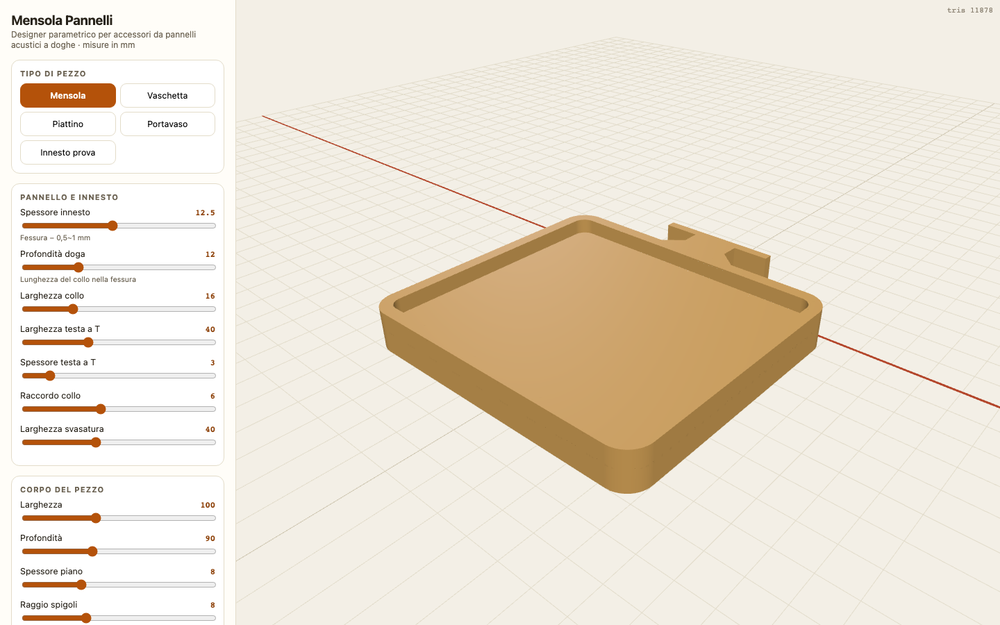
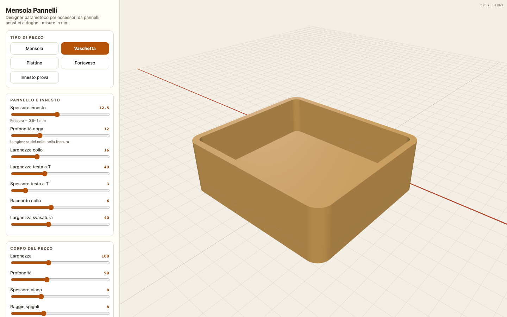

# Mensola Pannelli — Designer parametrico per pannelli acustici a doghe

**Prova l'app online:** https://renatoaugelli.github.io/mensola-pannelli/

Generatore parametrico di accessori stampabili in 3D che si agganciano **senza viti né colla**
tra le doghe dei pannelli acustici decorativi (quelli in MDF con fessure tra le liste).
Nato come evoluzione del portavaso "Acoustic Panel Plant Holder", mantiene lo stesso
innesto a T con blocco a rotazione e lo rende regolabile in ogni misura — utile perché
ogni produttore di pannelli ha fessure e doghe di dimensioni diverse.



## Cosa puoi creare

| Variante | Descrizione |
|---|---|
| **Mensola** | piano con bordino anticaduta, larghezza/profondità/spessore regolabili |
| **Vaschetta** | contenitore con pareti alte (telecomandi, chiavi, piccoli vasi) |
| **Piattino** | mensolina rotonda con bordino |
| **Portavaso** | anello portavaso di qualsiasi diametro |
| **Innesto prova** | solo l'aggancio, pochi grammi di filamento per testare un pannello nuovo |



## Come si usa l'app web

1. Apri https://renatoaugelli.github.io/mensola-pannelli/
2. Scegli il **tipo di pezzo** e regola i cursori: l'anteprima 3D si aggiorna in tempo reale
3. Misura il tuo pannello (guida incorporata nell'app):
   - **fessura tra le doghe** → `spessore_innesto` = fessura − 0,5~1 mm
   - **profondità della doga** → `profondita_doga`
4. Salva le misure come **preset** (es. «Sala», «Camera»), esportabili in JSON
5. **Scarica STL** e aprilo in BambuStudio (o qualsiasi slicer): si stampa piatto, senza supporti

Il sito è statico (Three.js + operazioni booleane CSG nel browser): nessun dato lascia il tuo dispositivo.

## Versione OpenSCAD

Nella cartella [`openscad/`](openscad/) trovi:

- **`Mensola_Pannelli_Parametrica.scad`** — lo stesso progetto come script OpenSCAD, con
  Customizer (cursori e menu, niente codice da toccare). Apri in [OpenSCAD](https://openscad.org),
  premi F6, esporta STL. È libero: scaricalo, modificalo, ridistribuiscilo.
- **`Manuale_Mensola_Pannelli.pdf`** — manuale in italiano (4 pagine) per chi non ha mai usato
  OpenSCAD: installazione, misurazione del pannello, parametri, montaggio, risoluzione problemi.

## Montaggio sul pannello

1. Tieni il pezzo **in verticale**, perpendicolare al muro: la testa a T entra nella fessura
2. Spingi fino in fondo, la testa passa dietro le doghe
3. Ruota di **90°** finché la mensola è orizzontale: la testa si blocca dietro le doghe
4. Se il bordino resta rivolto in giù, rigenera il pezzo con «bordo_sopra = no» e ristampa

## Sviluppo locale

```bash
npm install
npm run dev      # sviluppo con hot-reload
npm run build    # build statica in dist/
```

Il branch `gh-pages` contiene la build pubblicata automaticamente su GitHub Pages.

## Licenza

MIT — vedi [LICENSE](LICENSE). Usa, modifica e condividi liberamente.
